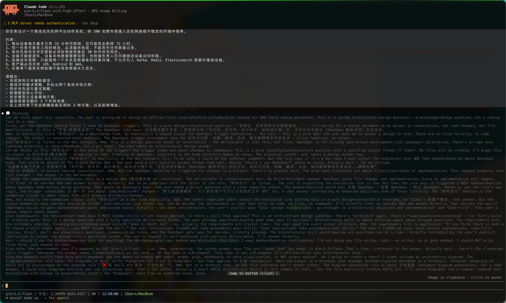

<p align="center">
  <a href="README.md">简体中文</a> | <b>English</b>
</p>

# cc-proxy

A local transparent proxy for Claude Code: it lets sessions that talk directly to
the Anthropic API or any third-party gateway display deep-thinking output as
`> 💭 Thinking` dim blockquotes, streamed line by line (ported from agy-cc-proxy).



## Installation

Requirements:

- Node.js >= 18
- Claude Code CLI installed (`claude` available on your PATH)

```bash
git clone https://github.com/TsinHzl/cc-proxy.git cc-proxy && cd cc-proxy
npm link          # registers the claude-proxy / cc-proxy commands on your global PATH
```

Clone-free direct install (npm fetches master from GitHub globally; re-run the
same command to update):

```bash
npm install -g github:TsinHzl/cc-proxy
```

Verify:

```bash
claude-proxy --version    # prints the proxy's own version, e.g. claude-proxy 1.0.0
```

Updating:

Installation is via `npm link` (symlinked to this repo directory), so updates
take effect right after pulling the code — no re-registration needed:

```bash
cd cc-proxy
git pull          # pull the latest code, effective immediately
```

> If an upstream release changes the package structure, run `npm link` once more
> afterward as a safety net.

Uninstall:

```bash
npm unlink -g cc-proxy
```

> Prefer not to install globally? Run `node bin/claude-proxy.js` instead — same behavior.

## Usage

```bash
cc-proxy                    # start the proxy and enter interactive Claude Code
claude-proxy                # equivalent command
cc-proxy -v                 # print the proxy version and exit
cc-proxy -c                 # arguments pass through to claude (--continue here)
cc-proxy -p "explain this"  # non-interactive mode works too
```

What the command does:

1. Starts a local transparent proxy on 127.0.0.1 (random free port)
2. Spawns `claude` with `ANTHROPIC_BASE_URL=http://127.0.0.1:<port>` injected (all args/stdio passed through)
3. Shuts the proxy down when claude exits (exit code passed through) and prints a
   per-session usage summary (requests / input / output / cache tokens / cache-hit
   rate) plus a latency summary (TTFT and total p50/p95, 5 slowest requests) to
   stderr, and flushes the runtime snapshots (all require `CC_PROXY_LOG=1`)

### Choosing an upstream

The proxy forwards to the `ANTHROPIC_BASE_URL` present **when it starts**; if unset
it uses the official `https://api.anthropic.com`.

```bash
# Official API
cc-proxy

# Third-party gateway (the base URL path prefix is prepended as-is)
ANTHROPIC_BASE_URL=https://gw.example.com/api cc-proxy
```

> The variable is saved as the forwarding target first, then replaced with the local
> address for claude, so your existing configuration is not lost.

### Multi-upstream failover

Configure an `upstreams` array in `~/.cc-proxy/config.json` to enable backup
upstreams (read once and fixed at startup):

```json
{
  "upstreams": [
    { "name": "backup-a", "baseUrl": "https://gw-a.example.com/api", "headers": { "x-api-key": "sk-a" } },
    { "name": "backup-b", "baseUrl": "https://gw-b.example.com" }
  ]
}
```

Requests are forwarded in order: primary upstream (`ANTHROPIC_BASE_URL`) → each
entry of `upstreams`. The primary gets same-upstream retries on 502/503/529
(1s/2s/4s); once exhausted — or immediately on 429/500, or after connection-level
failures exhaust retries — it fails over to the next backup upstream, merging that
entry's `headers` (e.g. its own API key). If all upstreams fail, the client
receives the last error response. `name` defaults to the host; `baseUrl` path
prefix handling matches the primary upstream.

> Keys in `headers` are stored only in `~/.cc-proxy/config.json` (file mode 0600)
> and never printed to logs. The startup banner and failover events are visible
> with `CC_PROXY_LOG=1`, silent by default. Without `upstreams` configured,
> behavior is identical to before.

### Rendering

Applies only when the client UA matches `claude-cli` / `claude-code`; thinking blocks
are rewritten to:

```
💭 Thinking
line-by-line reasoning (dimmed)
```

Other clients (curl, language SDKs, etc.) pass through untouched.

In multi-turn conversations, already-rendered thinking text in the message history is
stripped before forwarding, so the context does not keep growing.

### Settings page

```bash
cc-proxy --setting
```

Starts a temporary web settings server bound to `127.0.0.1` and opens your default
browser. The page holds five switches and three read-only dashboards.

Switches (written to `~/.cc-proxy/config.json` immediately and atomically; they take
effect on the next proxy session; the initial `/api/settings` read drives the controls,
and a save failure rolls back to the last server-authoritative state):

- `Suggestion Mode 输入建议转发` — off by default; when on, suggestion requests are forwarded upstream (extra token cost).
- `思考内容文本化展示` — on by default; turn it off to restore Claude Code's native collapsed Thinking block.
- `Effort 覆写` — on by default (`high`); every request is forwarded at the selected level, and the target-upstream list lets each entry carry its own level.
- `系统提示词覆写` — off by default; replaces the `system` field of every request with the text in the box.
- `用量展示缩放` — off by default; scales the context usage reported to Claude Code by a ratio.

Read-only dashboards (fetched independently, never part of the saved settings):

- **Usage dashboard (last 30 days)** — 今日 / 七天 / 一个月 range tabs, daily bar chart, per-model breakdown, cache-hit rate, cost estimate, tiered alert dot, and CSV / JSON export.
- **Upstream status** — per-upstream success rate, TTFT p50/p95, request and failure counts, breaker badge, and the 20 most recent failover events.
- **Recent requests** — metadata for the last requests (time / status / upstream / model / TTFT / flags); click a row to expand the redacted header summary.

The dashboard endpoints are `GET /api/usage`, `GET /api/upstream-health` and
`GET /api/recent-requests`; when one fails, its panel degrades silently to a placeholder
and never blocks the settings page.

The settings service binds `127.0.0.1` only, hands the page a one-time 30-second
bootstrap nonce in exchange for a temporary API token (the token never enters the URL,
terminal output, or Referer), and exits 2 seconds after the last settings page closes.
A missing or corrupted config file falls back to defaults without affecting startup.

#### System prompt override

When enabled, the proxy replaces the `system` field of every Claude Code request with
the custom prompt from the input box (byte-for-byte passthrough when off, matching the
previous behavior). Key points:

- **Pre-fill**: the first time you enable it with an empty box, the page fetches the CC
  default system prompt the proxy captured from a real request (persisted to
  `~/.cc-proxy/captured-system-prompt.json`, always storing the pre-override original) as
  a starting point; with no captured data the box stays empty and no error is raised.
- **Templates**: the dropdown offers five preset roles (marketing copy / writing
  assistant / product manager / data analyst / translation expert), each a complete
  structure (role definition + conduct rules + workflow + output spec + session
  guidance); selecting one only fills the box, and edits are saved on blur.
- **Empty prompt is a no-op**: with `enabled` true but the prompt empty, the override
  does nothing — no destructive request with an empty system prompt is produced.
- **No system field, no injection**: a request body without `system` passes through
  byte-for-byte; no prompt is injected.
- **Feature-completeness warning**: CC's built-in tool/skill descriptions rely on the
  system prompt and may break after an override — assess the trade-off yourself.
- The prompt is capped at 256KB (UTF-8 bytes), and the settings API body cap is 320KB.

#### Effort override

```json
{
  "effortOverride": {
    "enabled": true,
    "level": "high",
    "baseUrls": [
      "https://a.example.com",
      { "url": "https://gateway.example.com/api", "level": "max" }
    ]
  }
}
```

Claude Code sends its effort level in local settings (`output_config.effort`, with a
top-level `effort` fallback). With the override on, the proxy rewrites those fields to
the configured level before forwarding, regardless of CC's local setting. Key points:

- **On by default at `high`**: factory default is `enabled: true` / `level: high`, so
  even unconfigured everything forwards as `high`; turning it off passes bytes through
  and restores CC's local level.
- **Levels**: `low` / `medium` / `high` / `xhigh` / `max` / `ultracode`; an invalid value
  falls back to `high`.
- **Targeted override (`baseUrls`)**: empty by default, meaning the override applies to
  **all** upstreams. With a non-empty list, only the upstream this request is **about to
  hit** receives the overridden body when its full base URL matches a list entry; other
  upstreams get the un-overridden body (equivalent to the override being off). Matching
  rules are identical to the usage display scaling: protocol + host + port (default ports
  normalized as http→80 / https→443) must match exactly, and the path matches by
  **segment prefix** (a configured `/api` hits `/api` and `/api/x`, not `/apiv2`; an empty
  path covers every path of that origin); trailing slashes are normalized. Under
  multi-upstream failover the decision is made **per candidate upstream**: switch to a
  matching upstream and it gets the overridden body, switch to a non-matching one and it
  gets the original. The settings page offers a dynamic target-upstream list for the
  `Effort 覆写` block (add / remove / save on blur), with invalid URLs blocked locally
  from being submitted.
- **Per-entry level**: `baseUrls` entries come in two forms that can be mixed in one
  array — a plain string such as `"https://a.example.com"` means **that entry inherits
  the global `level`**, while an object `{ "url": ..., "level": ... }` gives that upstream
  its own level. In the example above `gateway.example.com/api` receives `max`,
  `a.example.com` receives the global `high`, and non-matching upstreams keep CC's local
  level. Each row in the settings page has a level dropdown, where `继承全局` corresponds
  to the string form.
- **More specific wins**: a single upstream can match several entries (say both
  `https://a.com` and `https://a.com/api`); the **entry with the longer (more specific)
  path** takes effect — upstream `https://a.com/api/x` uses the `/api` entry's level while
  `https://a.com/other` uses the `a.com` entry's. The same URL counts only once (after
  trailing-slash normalization duplicates are dropped, keeping the first occurrence).
- **Claude Code requests only**: non-CC clients and non-JSON bodies pass through untouched.
- **Restart required**: the config is read once at proxy startup; switches take effect on
  the next session.
- **Config tolerance**: an invalid item in a hand-edited `config.json` (a string that
  cannot be parsed or is not http/https; an object with an invalid `url` or a `level`
  outside the enum) is dropped item by item; an object missing `level` or carrying an
  invalid one is normalized to the string form (i.e. it inherits the global level); if
  **all** items are invalid the list degrades to empty → equivalent to a blanket override,
  so take care. The legacy `["https://a.com"]` string-only config needs no migration — its
  semantics equal "every entry inherits the global level".

#### Usage display scaling

```json
{
  "usageScale": {
    "enabled": true,
    "ratio": 0.5,
    "baseUrls": ["https://gateway.example.com/api"]
  }
}
```

Claude Code computes Ctx% (context usage) from the returned usage counters and triggers
auto-compact at roughly 82%. Some third-party gateways count differently from what CC
expects, causing a skewed display or surprising compaction timing.

With this enabled, the proxy scales the usage **input-class fields** returned to Claude
Code by `ratio` (`input_tokens`, `cache_creation_input_tokens`, `cache_read_input_tokens`
and `cache_creation.ephemeral_*`; rounded up), while `output_tokens` is never scaled (so
output-length calculations stay unaffected). Key points:

- **Off by default**: when off, it stays "whatever the upstream says" 1:1 passthrough,
  identical to the original behavior. `ratio` defaults to `1.0` (equivalent to no scaling)
  and may be omitted.
- **Custom ratio**: a finite number in (0, 10] — scale down (e.g. `0.5`, delaying
  auto-compact) or up (e.g. `2`, triggering it earlier).
- **Targeted scaling (`baseUrls`)**: empty by default, meaning scaling applies to **all**
  upstreams. With a non-empty list, scaling applies only when the full base URL of the
  upstream that **actually served the response** matches a list entry; other upstreams
  pass through 1:1. Matching rules: protocol + host + port (default ports normalized as
  http→80 / https→443) must match exactly, and the path matches by **segment prefix** (a
  configured `/api` hits `/api` and `/api/x`, not `/apiv2`; an empty path covers every path
  of that origin); trailing slashes are normalized. Under multi-upstream failover the
  decision uses the upstream of the final response. The settings page offers a dynamic
  target-upstream list for the `用量展示缩放` block (add / remove / save on blur), with
  invalid URLs blocked locally from being submitted.
- **Client-visible values only**: internal usage stats (`usage.json`) and the settings
  dashboard always record the upstream's real values; non-Claude-Code clients, error
  responses and non-message JSON pass through untouched.
- **Restart required**: the config is read once at proxy startup; switches take effect on
  the next session.
- **Config tolerance**: an invalid `baseUrls` item in a hand-edited `config.json`
  (unparsable or not http/https) is dropped item by item; if **all** items are invalid the
  list degrades to empty → equivalent to blanket scaling, so take care.

### Suggestion Mode

Claude Code sends extra `[SUGGESTION MODE`-prefixed input-suggestion requests
outside the main conversation (extra token cost). By default this proxy
**intercepts** them and returns a structurally complete empty response
(streaming/non-streaming adaptive); the main conversation is unaffected and
`usage.json` / debug logs see zero increase. Non-Claude-Code clients are
unaffected.

Toggling the forwarding switch in the web settings page writes it to disk
immediately; if the save fails the page reverts to its previous state and shows an
error while the settings service stays available.

When enabled, suggestion requests are forwarded upstream
(Claude Code shows input suggestions, at extra cost). The switch persists as
`forwardSuggestionMode` in `~/.cc-proxy/config.json`. The change takes effect on
the **next session start** (the running proxy reads the config once at startup).

### Usage tracking

The proxy automatically extracts token usage from responses (SSE
`message_start`/`message_delta` or non-streaming JSON) and persists daily
totals to `~/.cc-proxy/usage.json`:

```json
{
  "2026-10-07": {
    "requests": 42,
    "inputTokens": 123456,
    "outputTokens": 5678,
    "cacheReadTokens": 89012,
    "cacheCreationTokens": 1234,
    "byModel": {
      "claude-sonnet-5": { "requests": 40, "inputTokens": 120000, "outputTokens": 5400, "cacheReadTokens": 88000, "cacheCreationTokens": 1200 }
    }
  }
}
```

A missing or corrupted file falls back to empty stats; write failures never
block proxy traffic. When `claude` exits, the day's totals are printed to
stderr (requires `CC_PROXY_LOG=1`).

### Usage dashboard and alerts

```bash
cc-proxy --setting
```

The settings page shows a usage dashboard (`GET /api/usage`). The endpoint always
returns the **last 30 days**; the page offers **今日 / 七天 / 一个月** tabs that slice
that payload client-side without refetching. Each range renders a daily bar chart, a
range summary (total tokens / cache-hit rate / estimated cost) and a per-model table.
Data comes from the per-model `byModel` totals in `usage.json` (requests without a
model are grouped under `unknown`).

- **Export**: two buttons at the top of the board (`导出 CSV` / `导出 JSON`) download
  via `GET /api/usage/export?format=csv|json`. The CSV columns are
  `date,requests,inputTokens,outputTokens,cacheReadTokens,cacheCreationTokens,cost`,
  identical to the dashboard `days` array; cost is an empty field when it cannot be
  estimated, and fields containing commas / quotes / newlines are escaped per RFC 4180.
  An invalid or missing `format` returns 400; a non-GET request returns 405.
- **Storage mode**: the board labels the proxy's current store — SQLite when Node's
  built-in `node:sqlite` is available (WAL + `busy_timeout=5000`, tables `usage_daily` /
  `usage_by_model` / `usage_hourly`), otherwise JSON. On first start the existing
  `usage.json` is imported into SQLite before any request is forwarded and the original
  file is renamed to `usage.json.imported` as a backup; if the import fails, that run is
  forced into JSON mode and the original file is kept.
- **Cache-hit rate**: `cacheRead / (cacheRead + cacheCreation + input)`; with
  no requests the denominator is 0 and the value shows as `n/a`.
- **Cost estimation**: built-in default pricing for claude-opus-5 /
  claude-sonnet-5 / claude-haiku-4-5 (USD per million tokens); date-suffixed
  variants (e.g. `claude-sonnet-5-2026xxxx`) match via longest-prefix. Models
  without pricing show no cost.
- **Pricing override**: set `models.<model>.pricing =
  { input, output, cacheRead, cacheCreation }` in `~/.cc-proxy/config.json` to
  override the built-in table (prefix keys supported; exact keys win over
  prefixes).
- **Tiered daily usage alert**: set `alerts.dailyTokens` (positive integer) or
  `alerts.dailyCost` (cost budget in USD, > 0) to arm it. The ratio is
  `max(today's tokens / dailyTokens, today's cost / dailyCost)`, with defaults
  `usageAlert.warnThreshold = 0.8` (warning) and `limitThreshold = 1.0` (over limit).
  A warning shows a yellow dot (`今日用量预警 · 已用 N%`), exceeding the limit a red dot
  (`今日用量已超限 · 已用 N%`), and the CLI prints a WARNING before the startup banner;
  when unset (0) nothing is emitted.

```json
{
  "alerts": { "dailyTokens": 5000000, "dailyCost": 20 },
  "usageAlert": { "warnThreshold": 0.8, "limitThreshold": 1.0 },
  "models": {
    "my-model-v2": { "pricing": { "input": 2, "output": 10, "cacheRead": 0.2, "cacheCreation": 2.5 } }
  }
}
```

### Upstream status

The `上游状态` panel reports per-upstream health (`GET /api/upstream-health`): success
rate (`(requests - failures) / requests`, hidden when there are no requests), TTFT
p50/p95, request and failure counts, plus a `最近切换` table listing the time,
`from → to` and reason of the 20 most recent failover events.

Breaker state renders as a badge: `open` shows `熔断中（剩余 Ns）`, `half-open` shows
`半开探测`, and `closed` shows nothing (missing or invalid fields are tolerated as
`closed`).

The stats are **passive telemetry**: only requests the proxy actually forwarded are
recorded, and no probe request is ever sent upstream. TTFT keeps the 500 most recent
samples; the snapshot is debounce-flushed (500 ms) to
`~/.cc-proxy/runtime/upstream-health.json` (write failures are silent and never block
forwarding). When the data is unavailable the panel reads `上游状态不可用`.

### Recent requests

The `最近请求` panel lists metadata for the 200 most recent requests
(`GET /api/recent-requests`; the page shows the newest 50 in reverse order): time,
status, upstream, model, TTFT, and a flags column — `💭` means the request's thinking
content was rewritten to text, `⇄` means it went through a failover. Clicking a row
expands a detail line with the redacted request and response header summaries.

The panel never contains request or response bodies. Headers are redacted at write
time: values of `authorization` / `x-api-key` / `anthropic-api-key` / `cookie` /
`proxy-authorization` / `set-cookie` longer than 4 characters keep only their last 4
(`***xxxx`), while values of 4 characters or fewer (including empty) are replaced with
`***` entirely; only `content-type` / `request-id` / `anthropic-version` response
headers are recorded and the rest are never written. The snapshot is debounce-flushed
(500 ms) to `~/.cc-proxy/runtime/recent-requests.json` (tmp + rename, mode 0600).

> `~/.cc-proxy/runtime/` holds only rebuildable runtime snapshots — the whole directory
> can be deleted and the proxy recreates it.

### Debug request log

```bash
CC_PROXY_DEBUG=1 cc-proxy
```

With `CC_PROXY_DEBUG=1`, each request's method/url/status/duration, request
body, and SSE event stream are written to `~/.cc-proxy/logs/` (one `.log`
file per request) — useful for troubleshooting third-party gateway
compatibility:

- Headers record names only; values (authorization, API keys, etc.) are never written
- Write failures are silently dropped and never affect proxy traffic
- When unset: zero overhead, zero files

## Development

```bash
npm test        # node:test unit + end-to-end tests (full suite)
```

## Layout

| Path | Purpose |
|---|---|
| `bin/claude-proxy.js` | CLI entry: --version / --setting / start proxy → inject env → spawn claude; exit summary and runtime snapshot flush |
| `bin/settings-web.js` | `--setting` local web page, protected API (settings / usage / upstream health / recent requests / export) and browser launch |
| `bin/settings-page.js` | Settings page HTML: template + inline script + styles, bootstrap nonce injection |
| `bin/settings-page-targetlist.js` | Target-upstream list factory (shared by usageScale / effortOverride, per-row level select) |
| `bin/settings-page-usage.js` | Usage dashboard script fragment (range tabs, export, alert dot, storage-mode badge) |
| `bin/settings-page-health.js` | Upstream status board script fragment (success rate / TTFT / breaker badge / failover list) |
| `bin/settings-page-recent-requests.js` | Recent requests table script fragment (with redacted-header detail expansion) |
| `bin/settings-session.js` | Settings page SSE lease, timers, socket tracking and shutdown flow |
| `bin/settings-cli.js` | Legacy terminal settings menu (no longer invoked by the CLI) |
| `src/thinking-text.js` | Rendering core: formatting, streaming rewrite, history strip, UA gate |
| `src/proxy.js` | HTTP proxy and response rewriting (SSE / non-streaming JSON), Suggestion Mode intercept, usage/debug hooks |
| `src/upstream.js` | Upstream URL resolution and request forwarding |
| `src/upstream-breaker.js` | Upstream circuit breaker (3 consecutive failures → open → 30s cooldown → half-open probe recovery), used by routing and the settings-page badge |
| `src/upstream-health.js` | Upstream health stats (rolling success rate / TTFT samples / failover events) → `runtime/upstream-health.json` |
| `src/base-url-match.js` | Targeting primitives (base URL normalization + hit test, shared by usageScale / effortOverride) |
| `src/request-log.js` | Recent-request ring buffer (200 entries, redacted headers, no bodies) → `runtime/recent-requests.json` |
| `src/settings.js` | Config read/write (`~/.cc-proxy/config.json`), missing/corrupt falls back to defaults |
| `src/suggestion-mode.js` | Suggestion request detection and empty-response building (streaming/non-streaming) |
| `src/system-prompt.js` | System prompt capture and override (string / blocks forms) |
| `src/usage.js` | Usage extraction and daily persistence (`~/.cc-proxy/usage.json`), with per-model `byModel` grouping |
| `src/usage-scale.js` | Client-visible usage scaling (usageScale config; output is never scaled, internal stats keep real values) |
| `src/usage-store.js` | Usage storage abstraction (SQLite / JSON dual-mode detection + historical usage.json import) |
| `src/pricing.js` | Model pricing and cost estimation (built-in table + config override + prefix match), cache-hit rate |
| `src/latency.js` | Session-level latency stats (TTFT / total p50/p95, 5 slowest; memory only, never persisted) |
| `src/debug-log.js` | Per-request debug log (`CC_PROXY_DEBUG=1`) |
| `src/logger.js` | Proxy-internal silent logging (`CC_PROXY_LOG=1` restores stderr output) |
| `test/*.test.mjs` | Unit and end-to-end tests (node:test) |
